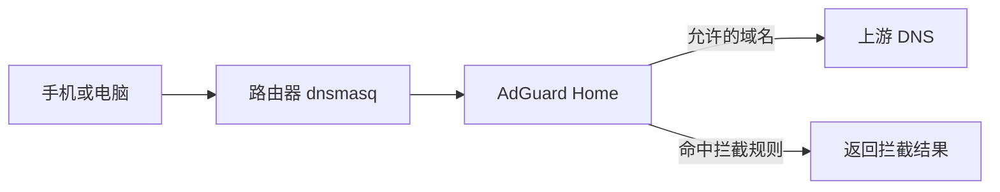

## AdGuard Home 能做什么

AdGuard Home 是一个网络级 DNS 过滤服务。设备查询域名时，它可以根据过滤列表拦截已知广告或跟踪域名，也能显示查询记录。把它放在软路由上后，手机、电脑和电视可以统一使用这台 DNS 服务，不必每个设备单独安装软件。

它不是万能广告拦截器：嵌在视频内容里的广告、应用内置推广和使用同一域名提供的内容与广告，可能无法靠 DNS 区分。过滤列表也可能误拦网站功能，所以要保留临时关闭或白名单的办法。




## 安装前先备份

先导出 OpenWrt 配置备份，并确认路由器存储空间足够。记录目前使用的 DNS 方案：是否启用了 dnsmasq、加密 DNS 插件或其他广告过滤器。多个 DNS 程序同时监听 53 端口，是最常见的启动冲突来源。

## 安装官方 OpenWrt 软件包

OpenWrt 官方软件源提供 AdGuard Home 软件包。通过 LuCI 的“系统 → 软件”更新软件列表，搜索并安装 adguardhome。也可以按系统版本使用 SSH 安装：

```sh
# OpenWrt 25.12 及之后版本使用 apk
apk update
apk add adguardhome

# OpenWrt 24.10 及更早版本通常使用 opkg
opkg update
opkg install adguardhome
```

只执行与你的系统相符的一组命令。第三方固件的包名、软件源和菜单可能不同，先查该固件的说明，不要混装官方不同版本的软件包。

## 完成首次设置

安装后启动服务，在同一局域网的浏览器打开路由器地址加端口 3000，例如 http://192.168.1.1:3000，完成初始化向导。具体地址以页面提示为准。设置管理账号和强密码；管理界面不要暴露到公网。

初始化时要分清两个端口：

- **管理界面端口**供你打开设置页面。
- **DNS 监听端口**供设备发送域名查询，通常会涉及 53 端口。

最稳妥的入门做法是让 AdGuard Home 先在一个空闲的本机端口（例如 5353）监听，再让 OpenWrt 自带 dnsmasq 把查询转发给它。这样 dnsmasq 仍负责 DHCP 设备发现，而 AdGuard Home 负责过滤与上游解析。不要让 dnsmasq 把请求转给自己，否则会形成循环。

## 把全家设备接到它上面

在 AdGuard Home 的 DNS 设置中填写可信的上游解析服务器，并保存。然后在 OpenWrt 的 DHCP/DNS 设置中，把 dnsmasq 的上游转发目标设为 AdGuard Home 的监听地址和端口。不同版本 LuCI 的菜单文字会变化；若使用 SSH，先阅读 OpenWrt 官方说明并备份 /etc/config/dhcp，再修改。

客户端一般继续从 DHCP 获取路由器地址作为 DNS，不要先在每台手机上手动填一个公共 DNS。否则客户端可能绕开路由器上的过滤。应用设置后，让一台测试设备断开 Wi-Fi 再重新连接，以刷新 DHCP 信息。

## 验证和调整过滤列表

在 AdGuard Home 查询日志中检查是否出现测试设备的 DNS 请求。用浏览器访问几个普通网站，确认页面能正常打开；然后在仪表板查看拦截统计。刚开始只启用一两份维护活跃的过滤列表，不要叠加几十份来源不明的规则。

网站功能异常时，可以在查询日志里找到被拦截的域名，确认它确实与页面功能相关，再添加单个允许规则。不要为图省事关闭整个防火墙或添加过宽的白名单。

## 常见故障

**AdGuard Home 启动失败：**检查日志是否提示地址已被占用；查看 dnsmasq、其他 DNS 服务是否也在监听相同地址和端口。

**设备没有使用过滤：**检查 DHCP 是否仍发放路由器 DNS、客户端是否手动配置了其他 DNS，以及设备是否重新获取了网络设置。

**安装后路由器不能解析域名：**停止 AdGuard Home 或暂时恢复原 dnsmasq 上游，先让路由器自身恢复解析，再逐项检查监听端口和上游地址。保持有线管理连接，避免把 DNS 调整和 WAN/LAN 改动一起做。

**误拦网站：**先在查询日志定位准确域名，再做最小范围的允许规则。

官方资料：[OpenWrt AdGuard Home 指南](https://openwrt.org/docs/guide-user/services/dns/adguard-home)、[AdGuard Home 项目](https://github.com/AdguardTeam/AdGuardHome)。
