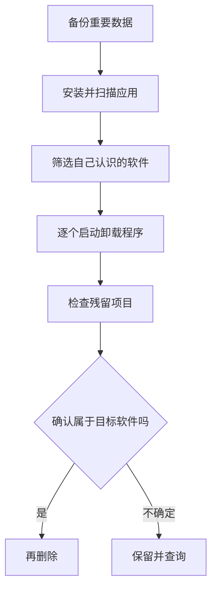

## 它解决什么问题

Windows 设置里的应用列表适合卸载一个软件；当电脑里积累很多旧程序时，Bulk Crap Uninstaller（常简称 BCUninstaller 或 BCU）能把已安装软件集中列出来，并帮助逐个或成组启动卸载流程。它还可以检查某些卸载后留下的文件或注册表项目。

“批量卸载”很强，也更容易误操作。第一次使用不要全选列表，不要把系统组件、驱动、运行库或你不认识的项目当成垃圾软件。目标是逐个确认，不是尽可能多地删除。

## 官方下载与安装

从 [BCUninstaller GitHub Releases](https://github.com/BCUninstaller/Bulk-Crap-Uninstaller/releases) 下载当前稳定版本；项目仓库也提供更新说明。只从官方发布页获取安装程序，不要下载被第三方重新打包的“精简版”。

安装前保存正在编辑的文档，关闭不需要的程序。若计划清理大量旧应用，可以先创建 Windows 系统还原点，并确保重要个人文件已有独立备份。还原点不能替代文档备份。

## 第一次扫描应用

启动 BCU 后，它会扫描系统中可识别的安装项目。阅读向导中的说明，理解列表来源和筛选项。列表可能包含 Windows Store 应用、传统安装程序和其他条目；名称相似并不意味着功能相同。

在列表中先用搜索框找一个你确认不再需要的普通应用。检查发布者、安装路径和名称，不确定时先到“设置 → 应用”或软件官网确认用途。

## 安全卸载一个程序

1. 选中一个你明确认识、且已决定不再使用的软件。
2. 确认软件窗口已关闭；保存数据、导出项目文件或浏览器书签。
3. 点击卸载，让该软件自己的卸载程序先完成。
4. 如果 BCU 随后提示查找残留，查看每个条目的路径和名称。
5. 只删除明显属于这款软件、且你确认不再需要的残留项。
6. 重启或重新打开相关应用，确认系统工作正常。

刚开始每次只卸载一个程序。等你熟悉列表和残留提示后，才考虑选择多个已确认的独立应用，并逐项检查结果。

## 这些内容不要随便删

- Windows 驱动、芯片组软件和设备厂商组件。
- Microsoft Visual C++ Redistributable、.NET 等共享运行库。
- 名称含 Service、Framework、Runtime、Driver 或系统组件但你不了解的条目。
- 仍有项目、游戏存档、邮件或配置数据的旧软件。
- 你无法确认发布者和安装路径的未知项目。

如果软件卸载后还有文件夹，不代表它一定是垃圾；里面可能有你的配置、项目或许可证文件。先备份再决定是否删除。

## 常见问题

**软件卸载失败：**先使用软件自带卸载程序或 Windows 应用设置；查看 BCU 显示的错误，不要马上用强制删除整个目录替代。

**卸载后某个功能不可用：**检查刚卸载的项目是否是共享运行库或硬件驱动，按官方来源重新安装对应组件。

**残留项目看不懂：**保留它，搜索确切的文件夹或发布者；不能确认归属就不要删除。

**是否可以一次清理所有旧项目：**不建议。先逐个清理并验证，特别是系统工具、开发环境和硬件驱动。

官方资料：[BCUninstaller GitHub 仓库](https://github.com/BCUninstaller/Bulk-Crap-Uninstaller)、[版本发布页](https://github.com/BCUninstaller/Bulk-Crap-Uninstaller/releases)。
