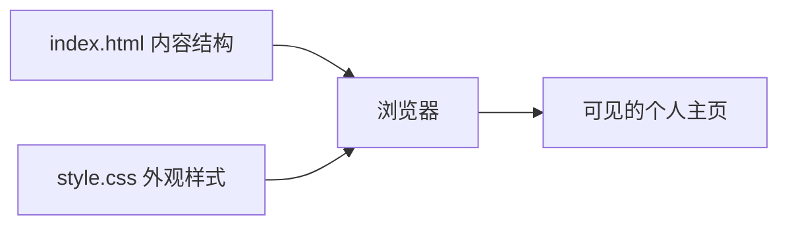

## 先理解网页的两层分工

HTML 负责放内容和说明结构，例如标题、段落、链接；CSS 负责颜色、间距、字体和排版。可以把 HTML 看成房子的骨架，把 CSS 看成墙面和家具。这个入门练习不需要安装 Node.js 或框架，只要一个文本编辑器和浏览器。




## 第一步：准备文件夹

安装 [Visual Studio Code](https://code.visualstudio.com/Download)，建立一个叫 my-first-page 的文件夹，在 VS Code 里打开它。新建两个文件：index.html 和 style.css。注意文件后缀必须分别是 html 和 css，不要保存成 index.html.txt。

## 第二步：写 HTML

把以下内容保存到 index.html。每个页面通常都有 head（页面信息）和 body（浏览器显示的内容）；标题、段落、列表和链接分别使用对应标签。

```html
<!doctype html>
<html lang="zh-CN">
<head>
  <meta charset="utf-8">
  <meta name="viewport" content="width=device-width, initial-scale=1">
  <title>我的第一个主页</title>
  <link rel="stylesheet" href="style.css">
</head>
<body>
  <main class="card">
    <p class="eyebrow">你好，欢迎来到</p>
    <h1>我的个人主页</h1>
    <p>我正在学习网页制作。这是我做的第一个页面。</p>
    <a href="https://developer.mozilla.org/zh-CN/docs/Learn_web_development">
      打开 MDN 前端学习指南
    </a>
  </main>
</body>
</html>
```

## 第三步：让页面好看一点

把以下样式保存到 style.css。点号开头的 .card 是“类选择器”，会找到 HTML 中 class="card" 的元素。浏览器窗口变窄时，max-width 和内边距会让卡片仍然好读。

```css
* {
  box-sizing: border-box;
}

body {
  margin: 0;
  min-height: 100vh;
  display: grid;
  place-items: center;
  padding: 24px;
  background: linear-gradient(135deg, #dbeafe, #fef3c7);
  color: #172554;
  font-family: system-ui, "Microsoft YaHei", sans-serif;
}

.card {
  width: min(100%, 640px);
  padding: 40px;
  border-radius: 24px;
  background: white;
  box-shadow: 0 20px 50px #17255422;
}

.eyebrow {
  color: #2563eb;
  font-weight: 700;
}

a {
  display: inline-block;
  margin-top: 12px;
  color: #1d4ed8;
}
```

## 第四步：在浏览器里打开

在文件管理器里找到 index.html，双击用浏览器打开。修改 HTML 或 CSS 后保存，再切回浏览器刷新。若改了样式却没变化，确认两个文件在同一个文件夹、HTML 中的样式表路径写成了 style.css，并检查文件有没有误加 .txt 后缀。

## 试着自己改三处

1. 把页面标题换成你自己的名字或博客名称。
2. 把卡片里的介绍改成两三句真实内容。
3. 调整背景颜色和卡片圆角，观察保存和刷新后的差异。

每次只改一项，比较容易看出 HTML 和 CSS 分别产生了什么效果。不要把账号密码写在公开网页代码里，因为静态页面中的内容任何访问者都能查看。

## 常见问题

**中文显示乱码：**确认 head 中有 charset="utf-8"，并用 UTF-8 保存文件。

**点击链接找不到页面：**检查网址是否完整，复制链接到浏览器单独打开。

**手机上文字挤成一团：**保留 viewport 元标签，不要给卡片写固定的大宽度；本示例用 max-width 限制最大宽度。

官方学习资料：[MDN Web 开发入门](https://developer.mozilla.org/zh-CN/docs/Learn_web_development)。
