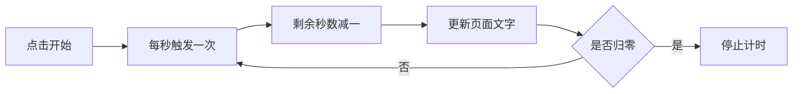

## 这个小项目会学到什么

HTML 负责按钮和计时文字，JavaScript 负责倒计时和响应点击。我们会做一个简化番茄钟：点“开始”后每秒减一，点“重置”回到 25 分钟。它不播放声音，也不会保存状态，先把最核心的交互弄明白。




## 第一步：建立三个文件

创建文件夹 pomodoro，里面放 index.html、style.css 和 app.js。三者分工明确：网页结构、页面外观、交互逻辑各放一处。用 [VS Code](https://code.visualstudio.com/Download) 打开这个文件夹。

在 index.html 中写入：

```html
<!doctype html>
<html lang="zh-CN">
<head>
  <meta charset="utf-8">
  <meta name="viewport" content="width=device-width, initial-scale=1">
  <title>我的番茄钟</title>
  <link rel="stylesheet" href="style.css">
  <script src="app.js" defer></script>
</head>
<body>
  <main class="timer">
    <h1>专注时间</h1>
    <p id="display" aria-live="polite">25:00</p>
    <button id="start">开始</button>
    <button id="reset">重置</button>
  </main>
</body>
</html>
```

defer 表示等 HTML 解析完成后再执行脚本。id 是元素的唯一名字，JavaScript 会用它找到对应的计时文字和按钮。

在 style.css 中加入简单样式：

```css
body {
  min-height: 100vh;
  margin: 0;
  display: grid;
  place-items: center;
  background: #f1eafe;
  font-family: system-ui, "Microsoft YaHei", sans-serif;
}

.timer {
  padding: 32px;
  border-radius: 20px;
  text-align: center;
  background: white;
}

#display {
  color: #5b21b6;
  font-size: 64px;
  font-weight: 700;
}

button {
  margin: 4px;
  padding: 10px 18px;
  border: 0;
  border-radius: 8px;
  cursor: pointer;
}
```

## 第二步：写倒计时逻辑

把下面代码保存到 app.js：

```javascript
const display = document.querySelector("#display");
const startButton = document.querySelector("#start");
const resetButton = document.querySelector("#reset");

const initialSeconds = 25 * 60;
let remainingSeconds = initialSeconds;
let timerId = null;

function renderTime() {
  const minutes = Math.floor(remainingSeconds / 60);
  const seconds = remainingSeconds % 60;
  display.textContent =
    String(minutes).padStart(2, "0") + ":" +
    String(seconds).padStart(2, "0");
}

startButton.addEventListener("click", () => {
  if (timerId !== null) return;

  timerId = window.setInterval(() => {
    remainingSeconds -= 1;
    renderTime();

    if (remainingSeconds <= 0) {
      window.clearInterval(timerId);
      timerId = null;
      display.textContent = "完成！";
    }
  }, 1000);
});

resetButton.addEventListener("click", () => {
  if (timerId !== null) window.clearInterval(timerId);
  timerId = null;
  remainingSeconds = initialSeconds;
  renderTime();
});

renderTime();
```

## 看懂几个关键点

- querySelector 找到页面中匹配选择器的元素。
- addEventListener 监听按钮点击，并在点击时执行函数。
- setInterval 每隔 1000 毫秒调用一次回调；clearInterval 停止它。
- Math.floor 和取余运算把总秒数变成分钟与秒。
- timerId 用来判断计时器是否已经启动，避免连续点按钮后出现多个计时器。

## 运行和调试

双击 index.html 在浏览器打开，点开始观察数字每秒变化，再点重置。若页面能显示但按钮没反应，先打开浏览器开发者工具的 Console，检查文件名拼写和报错；确认 app.js 与 index.html 在同一目录。

## 你可以继续加什么

增加暂停按钮、设置 25/5 分钟时长、完成后显示休息提示，或用 localStorage 保存设置。加功能时先画出“按钮触发什么、数据如何变化、页面显示什么”，再写代码。

## 常见问题

**数字变化不准：**浏览器计时器不是精确时钟，设备睡眠或后台标签可能延迟回调。更严谨的计时器应记录结束时间，再用当前时间计算剩余秒数。

**点很多次开始会跑得更快：**检查是否缺少 timerId 判断，确保同时只有一个 interval。

**刷新后重新开始：**这是预期行为，因为示例没有保存状态。

官方学习资料：[MDN 学习 Web 开发](https://developer.mozilla.org/zh-CN/docs/Learn_web_development)、[JavaScript 入门](https://developer.mozilla.org/zh-CN/docs/Learn_web_development/Core/Scripting)。
