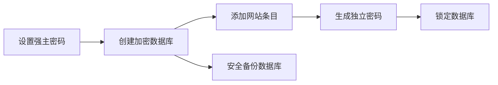

## 为什么用密码管理器

每个网站都用不同且足够长的密码，靠记忆几乎不现实。KeePassXC 是一款开源的本地密码管理器，它把登录信息存放在加密数据库文件中。你要记住一个主密码，再由程序帮你保存和生成其他密码。

本地数据库意味着你要自己保管文件、备份和同步；它不会自动替你恢复遗失的主密码。密码库文件、主密码和备份都应认真管理。

## 官方下载与安装

从 [KeePassXC 官方下载页](https://keepassxc.org/download/)选择 Windows、macOS 或 Linux 版本；可从 [官方入门指南](https://keepassxc.org/docs/KeePassXC_GettingStarted)查看安装说明。避免从搜索广告或软件下载站拿安装包。

安装后第一次打开，选择创建新数据库。根据向导填写数据库名称，例如“个人密码库”，并按提示创建主密码。尽量使用自己能记住的长密码短语，不要复用网站密码；不要把主密码发给别人或存进同一个未加密的文本文件。

如果软件提供紧急恢复信息或密钥文件选项，先理解它们的用途再使用。密钥文件若丢失，可能导致无法解锁数据库；若把密钥文件和数据库一起公开保存，也会削弱保护。

## 添加第一条登录信息

在数据库里点击新增条目，按字段填写标题、用户名、密码和网址。网址只填写正确的登录域名，避免将相似网站混在一起。对重要账户，可先用密码生成器创建一条长且随机的独立密码，再到对应网站更改密码，最后在 KeePassXC 保存。

一次只迁移少量账号，并立即验证能否登录。不要把所有网站密码批量复制进不可信的剪贴板工具或公开表格。

## 让浏览器填密码

KeePassXC 可以与官方浏览器扩展配合。先在 KeePassXC 设置中启用对应浏览器集成，再从浏览器官方扩展商店安装 KeePassXC-Browser。浏览器第一次连接桌面程序时，会要求确认连接请求；只批准自己刚刚操作的浏览器。

访问登录页后，扩展可显示匹配的条目。自动填充前检查网址和账号名称，不要在相似域名或弹窗页面盲目填密码。公用电脑上不要启用长期解锁或保存登录状态。

## 同步和备份怎么做

KeePassXC 的数据库通常是一个文件。你可以使用自己信任的同步方式在设备间传递数据库，但不要让多个设备同时修改同一个文件而不检查冲突。同步冲突时先复制一份两边文件，再按时间和内容比对，不要直接覆盖较新的数据。

至少保留一份加密数据库的独立备份，并定期在另一台设备上测试能否打开。数据库损坏、同步误删或忘记主密码，都可能造成永久无法访问。

## 常见问题

**忘了主密码怎么办？**没有主密码或有效恢复方式时，通常无法解密数据库。应用不会通过客服“重置”你的主密码，因此要提前设计自己能记住的主密码和安全备份方案。

**浏览器扩展看不到条目：**确认 KeePassXC 已解锁、浏览器集成已开启、连接请求已批准，并检查条目网址是否匹配当前网页。

**要不要把数据库传到网盘？**是否使用云盘由你自行评估。数据库本身加密并不意味着账号、设备、分享链接和备份习惯都没有风险；启用强主密码、双重认证和版本历史，并控制访问权限。

官方资料：[下载](https://keepassxc.org/download/)、[入门指南](https://keepassxc.org/docs/KeePassXC_GettingStarted)、[用户手册](https://keepassxc.org/docs/KeePassXC_UserGuide)。
