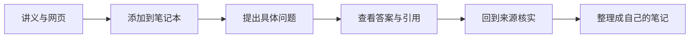

## 它和普通聊天有什么不同

普通 AI 聊天可以回答很多开放问题；NotebookLM 的重点是围绕你提供的一组资料工作。比如把课程讲义、老师发的 PDF 和自己的笔记放进同一个笔记本，再问“这几份资料对某个概念分别怎么解释”。

它适合做初步整理、找出资料中的相似点和差异。它生成的答案仍可能出错，因此“带有引用”也不等于“绝对正确”：要点开引用，确认原文确实支持答案。




## 第一步：建立一个主题笔记本

打开 [NotebookLM](https://notebooklm.google.com/)，使用 Google 账号登录并新建笔记本。建议一册只处理一个主题，例如“家用 NAS 入门”或“本学期生物复习”。资料太杂时，拆成多个笔记本，比把完全不同的主题混在一起更容易问出好答案。

给笔记本起清楚的名字，并在描述或首条提问中说明用途：你是要准备考试、读懂设备手册，还是做几篇文章的比较。这样后续整理结果时不容易混淆。

## 第二步：添加来源

点击添加来源，选择页面当前提供的类型。常见来源包括本地文件、复制的文字和网页链接；支持的文件格式与数量可能随产品更新而变化，以页面实际显示为准。对于网页来源，添加链接不代表之后会实时跟踪网页更新，重要资料要记下版本或发布日期。

上传前整理一下：

- 先删除无关章节和重复文件。
- 文件名带上主题、版本或日期。
- 个人资料、账号信息和不该外传的公司文件不要上传。
- 如果是扫描版 PDF，先确认它可以选中或识别文字；纯图片扫描件可能无法正确检索。

## 第三步：提一个能核对的问题

初学者可以从“总结某一份资料”开始：

```text
根据我选中的这份讲义，用 5 个要点总结第二章。
每个要点后列出对应的引用位置；没有明确写出的内容不要补猜。
```

比较多个来源时，再问：

```text
比较两份资料对“缓存”的解释。
请分成“相同点”“不同点”“各自引用位置”三栏。
```

范围越具体，回答越容易验证。不要只问“这门课讲了什么”，因为大问题往往会得到很长但不够可用的总结。

## 第四步：检查引用，不照单全收

查看答案下方的引用标记，点开对应来源，读前后几句。重点检查：

1. 引用是否真的支持这条结论，而不是只出现了相同关键词。
2. 单位、日期、否定词和限定条件有没有被忽略。
3. 不同文件是否使用了不同定义或版本。

遇到矛盾时，把两段原文都指出来，让它解释差异，并保留原文链接或页码。最后的笔记最好由你自己复述一遍；只复制 AI 的总结，不利于真正学会。

## 进阶用法：把笔记变成复习材料

你可以要求它根据来源生成术语表、章节提纲、练习题或复习卡片。例如“只根据来源出 10 道选择题，最后单独给答案和引用”。先自己完成题目，再让它解释错题，学习效果通常比直接看答案好。

对设备说明书，可以问“安装前需要准备什么”“某个灯闪烁代表什么”；对合同或政策文件，则只用来定位条款、整理问题，涉及法律或重要决策时仍应向专业人员确认。

## 常见问题

### 没搜到我刚添加的内容

检查来源是否仍在加载、文件是否有可识别文字、问题是否点选了正确来源。把问题缩小到文件名和章节，通常更容易定位。对于图片扫描件，考虑先做 OCR，再把识别文本作为来源。

### 引用看起来对，结论却不对

引用的作用是方便回查，并不能阻止模型推理错误。特别要注意数字计算、跨文件归纳和“因此一定会发生”这类推断。回原文核对，并把无法由来源直接证明的部分标出来。

### 是否可以上传所有资料

不建议。只上传当前任务需要的资料，并遵守账号所在地区、学校或单位的数据规则。用公开或脱敏副本练习即可。

官方帮助：[添加或发现笔记本来源](https://support.google.com/gemininotebook/answer/16215270?hl=zh-Hans)。
