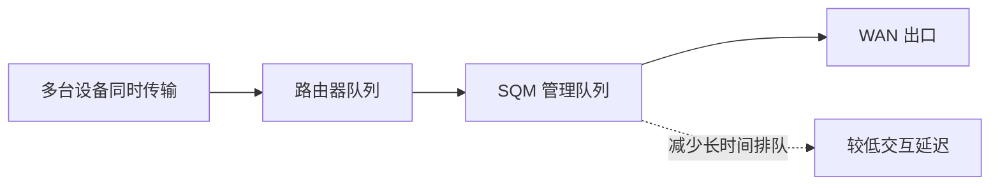

## 为什么带宽够，游戏还是会卡

家里有人下载大文件或上传视频时，网页打开慢、语音延迟高、游戏突然飙 ping，不一定是 Wi-Fi 信号差。一个常见原因是 **Bufferbloat（缓冲膨胀）**：网络设备把太多待发送数据排成长队，吞吐量看起来很高，但实时数据要在队伍后面等。

SQM（Smart Queue Management，智能队列管理）会对队列进行管理，并按设定速率整形。它不能让宽带变快，却可能在拥塞时减少排队延迟。它最适合路由器确实是家中瓶颈的场景。




## 第一步：量出真实上下行速度

在没有其他设备大量下载时，使用有线电脑连续测速几次，分别记录下载和上传速度。用实际稳定值，而不是套餐宣传的峰值。若只有 Wi-Fi 结果，信号质量会混进测试，尽量改用网线。

在速度比较稳定的基础上，初始设置可以从测速稳定值的 85% 到 95% 试起。比如多次实测上传约 40 Mbps，可先尝试 34 到 36 Mbps；下载约 300 Mbps，可先从 255 到 285 Mbps 开始。若高峰时运营商速度变化很大，整形值应以拥塞时能稳定达到的值为参考。

## 第二步：安装 SQM

在 LuCI 的软件管理页面搜索并安装 luci-app-sqm，它会带入常用的 SQM 脚本依赖。OpenWrt 25.12 及之后通常用 apk，较早版本多用 opkg。如果要用命令行，先确定系统版本与包管理器：

```sh
# 25.12 及之后版本
apk update
apk add luci-app-sqm

# 24.10 及更早版本通常使用
opkg update
opkg install luci-app-sqm
```

安装后刷新页面，在“网络 → SQM QoS”中打开配置。菜单名称可能随固件翻译或插件版本略有不同。

## 第三步：选对 WAN 接口

先确认实际承载互联网流量的 WAN 设备。它可能叫 wan、pppoe-wan 或某个 VLAN 设备名；选错接口会出现“功能已启用但没有效果”。可以从网络接口页面查看 WAN 状态，或在 SQM 页面使用系统列出的设备提示。

队列脚本可先尝试 CAKE 或向导推荐的默认配置；链路层类型与额外选项按宽带接入方式填写。若你不确定运营商封装方式，先保留默认值，观察测试结果，不要照抄不匹配的高级参数。

## 第四步：启用并验证

填入上下行起始速率，保存并应用。重新测速时，不要只看最高下载速度，还要在另一台设备持续上传或下载，同时观察网页、语音或游戏延迟。对比启用前后的空闲 ping 和负载时延。

如果速度明显下降或延迟没有改善，每次只调一个参数：先检查 WAN 接口是否选对，再小幅调整整形速率。下行改善不足时把下载速率稍微调低；上行排队明显时优先调整上传值。每次调整都重新测试并记录结果。

## SQM 的取舍与限制

SQM 要由路由器处理每个数据包，低性能设备在高速宽带上可能因 CPU 不够而达不到套餐峰值。启用后跑测速时观察路由器 CPU；若 CPU 长期接近满载，可提高速率限制、选择较轻的方案，或评估更强的路由器。

它不会修复无线覆盖盲区、干扰、线路故障、运营商拥塞或上游路由器的瓶颈。如果 SQM 跑在二级路由上，而真正拥塞发生在前级光猫路由器，改善会有限。

## 常见问题

**启动后网速变慢：**确认速率填写单位是 Mbps，且没有把上下行颠倒。初始值太低会主动限速。

**启用后毫无变化：**核对 WAN 接口；确认 SQM 状态为运行；检查是否有另一个 QoS 插件同时抢管队列。

**只在 Wi-Fi 测试时有波动：**改用有线电脑测试，并确认路由器没有同时跑高负载任务。

**哪里能找到可靠设置说明：**参考当前 OpenWrt 版本的 SQM 文档，不要直接套用旧固件截图。

官方文档：[OpenWrt SQM 配置](https://openwrt.org/docs/guide-user/network/traffic-shaping/sqm_configuration)、[SQM 原理与说明](https://openwrt.org/docs/guide-user/network/traffic-shaping/sqm)。
