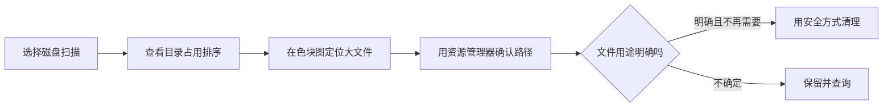

## 先看清楚，再决定怎么清理

电脑提示磁盘空间不足时，很多人会删下载目录里的文件，却不知道真正占空间的可能是游戏、虚拟机、旧安装包或视频素材。WinDirStat 会扫描磁盘并用目录列表和色块图展示空间分布，帮助你找到“大户”。

它是分析工具，不会替你判断文件是否安全删除。看见一个很大的系统文件，不代表可以直接删。**先定位和确认，再通过对应软件的设置或 Windows 工具清理。**

## 下载和首次扫描

从 [WinDirStat 官方下载页](https://windirstat.net/download/)选择适合 Windows 的安装包；源码与发布也可从[官方 GitHub](https://github.com/windirstat/windirstat)查看。下载后按 Windows 提示安装，并确认发布者与来源无异常。

启动 WinDirStat，选择要扫描的盘符，例如 C:，再开始扫描。第一次可能需要几分钟，文件很多或磁盘较慢时会更久。只扫描你需要了解的磁盘，不必同时扫所有移动硬盘。

## 怎么看扫描结果

窗口通常分成几块：

- **目录树/列表**：显示文件夹层级和占用比例，可以按大小排序。
- **扩展名统计**：显示视频、压缩包、程序文件等类型的总体占比。
- **色块图**：每个矩形代表文件，面积越大代表文件越大；颜色常用来区分文件类型。

先在目录树中找到占用最大的文件夹，再点击对应色块，查看它的路径和类型。也可以右键选择在资源管理器中打开，用 Windows 自带属性再次确认文件位置。

## 找到大文件后的安全处理

遇到自己下载的旧 ISO、重复视频或明确废弃的安装包，可以先复制到外置硬盘或确认无需保留后，再通过资源管理器删除。清空回收站之前，再看一次清单。

如果大文件属于某个应用或游戏，优先在该软件设置里卸载、迁移库或清除缓存。对 OneDrive、网盘同步目录，删除前确认是否会同步到云端并影响其他设备。

## 这些系统项目不要手动删

不要直接删除 Windows、Program Files、ProgramData、用户配置目录里的不明文件。特别不要因为 WinDirStat 显示它们很大，就手动删除 WinSxS、pagefile.sys、hiberfil.sys 或驱动目录。系统文件应通过 Windows 设置、磁盘清理、存储感知或对应应用的卸载程序处理。

## 常见问题

**扫描结果看起来不完整：**以普通用户运行时，某些目录可能没有访问权限。只有在确有需要并理解风险时才用管理员权限扫描；不要因此获得权限后就删除所有不可访问的文件。

**文件正在使用，删不掉：**关闭对应程序，或使用软件自身的清理方式；不要强行结束不认识的系统进程。

**扫描结束后空间没有变多：**WinDirStat 只分析，不会自动清理。删除前要确认内容、备份和回收站状态。

**想清理系统缓存：**使用 Windows 的“设置 → 系统 → 存储”或磁盘清理，并检查每类项目的说明。

官方入口：[下载页面](https://windirstat.net/download/)、[项目仓库](https://github.com/windirstat/windirstat)。
